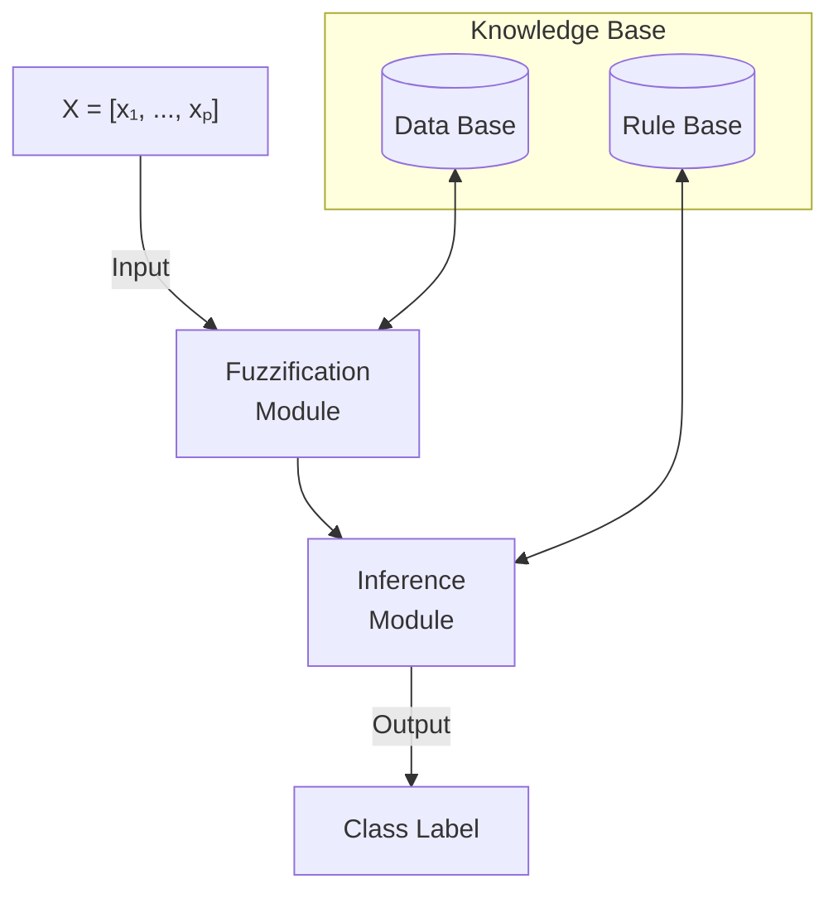
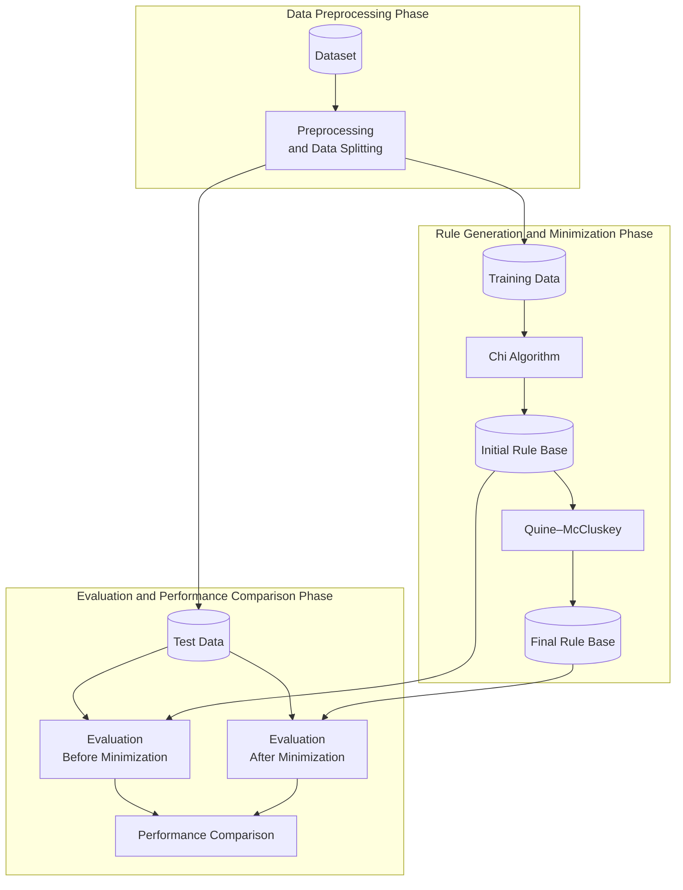

# Frbcs_xai

## 📖 Project Overview

<dl>
<ul>

Explainability and interpretability are major concerns in 
Artificial Intelligence (AI), particularly in sensitive 
domains such as healthcare, finance, and justice, where 
understanding model decisions is essential.

Explainable Artificial Intelligence (XAI) encompasses 
approaches designed to make AI systems and their decisions 
more understandable to users.

This project, developed as part of my master's research, 
focuses on optimizing <strong>Fuzzy Rule-Based Classification 
Systems (FRBCS)</strong>.

These systems are inherently explainable, interpretable, 
and transparent due to their knowledge representation 
through linguistic IF–THEN rules. Our approach primarily 
aims to minimize the number of fuzzy rules in the system's 
knowledge base while preserving the classifier's predictive 
performance.

</ul>
</dl>

## ❓ Problem Statement

<dl>
<ul>

Fuzzy Rule-Based Classification Systems (FRBCS) are used 
across various domains, either independently or in 
combination with other algorithms, particularly to improve 
decision-making transparency. Despite this advantage, one 
of their major challenges is the potentially large number 
of rules generated in their knowledge base. This 
proliferation of rules can compromise system interpretability,
increase complexity, and, in some cases, negatively affect 
predictive performance.

</ul>
</dl>

## 🎯 Project Objectives

<dl>
<ul>

The objective of this study is to develop a robust and less 
complex Fuzzy Rule-Based Classification System (FRBCS) by 
minimizing the number of rules in its knowledge base while 
preserving predictive performance. This approach aims to 
promote explainable and interpretable AI, particularly in 
high-impact domains such as healthcare and finance.

</ul>
</dl>

## 💡 Proposed Solution & Key Contributions

<dl>
<ul>

To achieve our dual objective of reducing the number of fuzzy 
rules while preserving the classifier's predictive performance, 
we adopted the Quine–McCluskey algorithm. This tabular method, 
based on combinational logic, provides a deterministic approach 
to Boolean function minimization. Unlike many heuristic 
optimization methods, it does not require optimization 
hyperparameters.

In this study, we leverage this algorithm to minimize the 
fuzzy rule base of the FRBCS while evaluating its impact on 
classification performance.

</ul>
</dl>

## 📊 Experimentation Datasets

<dl>
<ul>

One of the datasets used in our experiments is <strong>Banknote 
Authentication</strong>, available from the UCI Machine Learning 
Repository. It contains 1,372 instances, four numerical 
features, and one binary target variable used to distinguish 
genuine banknotes (class 0) from forged banknotes (class 1).

The features are extracted from banknote images. For 
additional information about the dataset and its creators, 
please refer to the official UCI source listed in 
the References & Citation section.

</ul>
</dl>

## 🧪 Proposed Methodology

<dl>
<ul>

Our methodology consists of five main stages:

- Data Acquisition and Exploration: Retrieve and explore the 
dataset to identify potential issues, particularly missing 
values and class imbalance.

####

- Data Preprocessing: Apply a modified version of the Synthetic 
Minority Over-sampling Technique (SMOTE) to address class 
imbalance when necessary. Then, use a modified Principal 
Component Analysis (PCA) approach to select relevant original 
features rather than generating new components, thereby 
preserving feature interpretability.

####

- Fuzzy Rule Generation: Use the Chi algorithm, inspired by the 
Wang–Mendel approach, to generate fuzzy classification rules 
from training data.

####

- Fuzzy Rule Minimization: Apply the Quine–McCluskey algorithm 
to reduce the number of fuzzy rules in the classifier's 
knowledge base.

####

- Experimentation and Evaluation: Conduct experiments using the 
previously described dataset and evaluate the two main 
objectives: the rule reduction rate and the classifier's 
predictive performance before and after minimization.

</ul>
</dl>

## 📈 Experimental Results & Evaluation

## 🗺️ Development Roadmap

## 🛠️ Technologies & Tools

<dl>
<ul>

- <strong>Python 3.11</strong> — Core programming language for FRBCS implementation.
- <strong>uv</strong> — Python environment and dependency management.
- <strong>Pandas & NumPy</strong> — Data manipulation, numerical computations, and preprocessing.
- <strong>Matplotlib & Plotly</strong> — Exploratory data analysis and data visualization.
- <strong>Scikit-learn</strong> — Base estimator interface and model evaluation utilities.
- <strong>ucimlrepo</strong> — Programmatic access to UCI Machine Learning Repository datasets.
- <strong>PyCharm</strong> — Integrated development environment (IDE).
- <strong>Git & GitHub</strong> — Version control and source code management.

</ul>
</dl>

## 🏗️ System Architecture

The FRBCS architecture consists of a knowledge base, a fuzzification module, and an inference module. The knowledge base contains a data base defining fuzzy sets and a rule base storing fuzzy classification rules.




## 🔄 System Workflow

The experimental workflow consists of three main phases: data preprocessing, fuzzy rule generation and minimization, and performance evaluation. The initial and minimized rule bases are evaluated using the same test dataset to compare classification performance and rule reduction.



## 📁 Project Structure

```text

frbcs_xai/
│
├── src/
│   └── frbcs_xai/
│       ├── __init__.py
│       │
│       ├── data/                         → Data loading and validation
│       │   ├── __init__.py
│       │   └── loader.py                 → UCI dataset loading
│       │
│       ├── preprocessing/                → Data preprocessing
│       │   ├── __init__.py
│       │   ├── cleaning.py               → Data cleaning and preparation
│       │   ├── feature_selection.py      → Relevant feature selection
│       │   └── resampling.py             → Class balancing
│       │
│       ├── frbcs/                        → Fuzzy rule-based classifier
│       │   ├── __init__.py
│       │   ├── fuzzySet.py               → Fuzzy set representation
│       │   ├── fuzzyVariable.py          → Fuzzy linguistic variables
│       │   ├── dataBase.py               → Fuzzy sets and membership functions
│       │   ├── fuzzyRule.py              → Fuzzy rule representation
│       │   ├── knowledgeBase.py          → FRBCS knowledge base
│       │   ├── frbcsClassifier.py        → Main FRBCS classifier
│       │   ├── rule_generation.py        → Fuzzy rule generation
│       │   ├── fuzzification.py          → Fuzzification operations
│       │   ├── inference.py              → Fuzzy reasoning and prediction
│       │   └── main.py                   → FRBCS execution entry point
│       │
│       ├── optimization/                 → Fuzzy rule optimization
│       │   ├── __init__.py
│       │   └── rule_minimization.py      → Quine-McCluskey algorithm
│       │
│       ├── evaluation/                   → Model performance evaluation
│       │   ├── __init__.py
│       │   ├── metrics.py                → Classification metrics
│       │   └── comparison.py             → Before/after optimization
│       │
│       └── pipelines/                    → Experiment orchestration
│           ├── __init__.py
│           └── training.py               → End-to-end training workflow
│
├── data/
│   ├── raw/                              → Original datasets (optional)
│   └── processed/                        → Preprocessed datasets (optional)
│
├── notebooks/
│   ├── eda.ipynb                         → Exploratory data analysis
│   ├── preprocessing.ipynb               → Preprocessing experiments
│   └── experiments.ipynb                 → Research experiments
│
├── tests/
│   ├── test_preprocessing.py
│   ├── test_rule_generation.py
│   ├── test_rule_minimization.py
│   └── test_classifier.py
│
├── scripts/
│   └── run_experiment.py                 → Experiment entry point
│
├── results/
│   ├── figures/                          → Generated visualizations
│   ├── metrics/                          → Performance results
│   └── rules/                            → Generated and minimized rules
│
├── pyproject.toml
├── README.md
└── .gitignore

```

## ⚙️ Installation & Usage

## 👤 Author & References

<dl> <ul> Aboubacar Bangoura </ul></dl>


## 📚 References & Citation
<dl>
<ul>

- Lohweg, V. (2012). Banknote Authentication [Dataset]. UCI 
Machine Learning Repository. https://doi.org/10.24432/C55P57

</ul>
</dl>